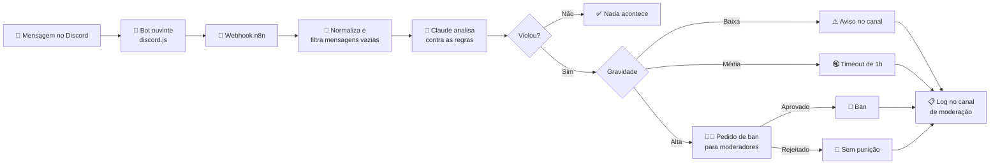

<div align="center">

# 🛡️ Ralf the Officer

**Moderação inteligente para Discord com IA e automação**

Um bot que entende o *contexto* das conversas, não só palavras proibidas,
e aplica punições proporcionais sem tirar o ser humano do controle.


</div>

---

## 📖 Sobre o projeto

Moderar comunidades grandes no Discord é cansativo, e as ferramentas tradicionais
dependem de listas de palavras: bloqueiam o que é inofensivo e deixam passar
ofensas escritas de forma criativa.

O **Ralf** é um experimento de como **IA e automação** podem trabalhar juntas
nesse problema:

- 🧠 **A IA avalia**: o Claude lê cada mensagem e decide se ela viola as regras do servidor, com qual gravidade e por quê.
- ⚙️ **A automação executa**: um workflow no n8n aplica a punição com regras fixas e previsíveis.
- 🧑‍⚖️ **O humano decide o que é grave**: banimentos só acontecem com a aprovação de um moderador.

> Este repositório também documenta a jornada de construção: as decisões,
> os erros e o que aprendi integrando IA a um fluxo de automação real.

---

## ⚙️ Como funciona



1. **Bot ouvinte**: um bot leve em `discord.js` escuta as mensagens do servidor e as encaminha ao n8n, ignorando bots, mensagens de sistema e DMs.
2. **Classificação com IA**: o Claude recebe a mensagem e as regras do servidor e responde **sempre no mesmo formato JSON**:
   ```json
   {
     "violou": true,
     "regra": "1",
     "gravidade": "media",
     "motivo": "Ofensa direta a outro membro"
   }
   ```
3. **Roteamento**: o workflow lê a gravidade e escolhe a punição correspondente.
4. **Registro**: toda ação vai para um canal de moderação, com membro, regra, gravidade e motivo.

---

## ⚖️ Níveis de punição

| Gravidade | Exemplos | Ação | Automática? |
|---|---|---|:---:|
| 🟢 **Nenhuma** | Conversa normal | Nada acontece | — |
| 🟡 **Baixa** | Palavrão isolado, flood leve | Aviso público respondendo à mensagem | ✅ |
| 🟠 **Média** | Ofensa direta, spam repetido | Timeout de 1 hora | ✅ |
| 🔴 **Alta** | Discurso de ódio, ameaças, golpes | Pedido de **ban** aos moderadores | ❌ exige aprovação |

Casos que não se encaixam em nenhuma categoria vão para **revisão manual**.

---

## 🧭 Decisões de design

### Workflow, não agente
Um *agente* de IA decide sozinho quais ações tomar. Aqui, **a IA só avalia** e o
workflow **executa regras fixas**. O comportamento fica previsível, fácil de
entender e de ajustar.

### Humano no circuito para o que é irreversível
Avisos e timeouts são leves e temporários, por isso são automáticos.
O **ban é permanente**, então o bot apenas *pede* e um moderador aprova ou rejeita
com um clique.

### Na dúvida, não punir
Em casos ambíguos, a IA é orientada a não apontar violação. Punir um inocente
prejudica mais a comunidade do que deixar passar um caso limítrofe.

### Saída estruturada
O Claude responde num esquema JSON fixo, e o workflow decide com base nesses
campos. Isso torna cada decisão consistente e fácil de auditar.

### Transparência
Toda punição é registrada com o motivo, para que a equipe possa revisar e
corrigir as decisões da IA.

---

## 🧰 Tecnologias

| Camada | Ferramenta | Papel |
|---|---|---|
| Captura | [discord.js](https://discord.js.org) | Escuta as mensagens pelo Gateway do Discord |
| Orquestração | [n8n](https://n8n.io) | Workflow visual que conecta tudo |
| Inteligência | [Claude](https://www.anthropic.com/claude) (Anthropic) | Classifica as mensagens contra as regras |
| Ação | Discord API | Aviso, timeout, ban e logs |

---

## 📁 Estrutura

```
.
├── bot/
│   ├── index.js          # Bot ouvinte: captura e encaminha mensagens
│   ├── package.json
│   └── .env.example      # Variáveis de ambiente necessárias
├── n8n/
│   └── workflow.json     # Workflow exportado do n8n
└── README.md
```

---

## 🚀 Como rodar

### Pré-requisitos
- [Node.js](https://nodejs.org) 20.6 ou superior
- Uma conta no [n8n](https://n8n.io) (cloud ou self-hosted)
- Uma chave de API da [Anthropic](https://console.anthropic.com)
- Um aplicativo criado no [Discord Developer Portal](https://discord.com/developers/applications)

### 1. Criar o bot no Discord
1. Crie uma aplicação e, na aba **Bot**, gere o token.
2. Ative o **Message Content Intent**.
3. Em **OAuth2 → Gerador de URL**, marque `bot` com as permissões *Send Messages*, *Moderate Members* e *Ban Members*, e adicione o bot ao seu servidor.
4. No servidor, coloque o cargo do bot **acima** dos cargos dos membros.

### 2. Configurar o n8n
1. Importe `n8n/workflow.json`.
2. Configure as credenciais do **Anthropic**, do **Discord Bot** e do **Header Auth** do webhook.
3. Escolha o canal de moderação nos nós de aprovação e de log.
4. Edite as **regras do seu servidor** no prompt do nó *Classificar com Claude*.
5. Ative o workflow e copie a **URL de produção** do webhook.

### 3. Rodar o bot ouvinte
```bash
cd bot
npm install
cp .env.example .env
npm start
```

| Variável | Descrição |
|---|---|
| `DISCORD_TOKEN` | Token do bot |
| `N8N_WEBHOOK_URL` | URL de produção do webhook |
| `N8N_WEBHOOK_SECRET` | Valor configurado no Header Auth do n8n |

### 4. Testar
Use um servidor de testes e uma conta secundária, e acompanhe cada mensagem
na aba **Executions** do n8n.

---

## 🗺️ Próximos passos

- [ ] **Punição em escada**: considerar o histórico do membro (reincidentes sobem de nível)
- [ ] **Triagem em duas etapas**: um modelo rápido primeiro e o modelo avançado só quando necessário
- [ ] **Painel de estatísticas** da moderação
- [ ] **Recurso de apelação** para membros punidos

---

## 📚 Lições aprendidas

> *Espaço para registrar a jornada: o que funcionou, o que deu errado e o que mudaria.*

---

## 🤝 Contribuindo

Sugestões, issues e pull requests são bem-vindos. Se você adaptar o projeto
para a sua comunidade, adoraria saber como ficou!
